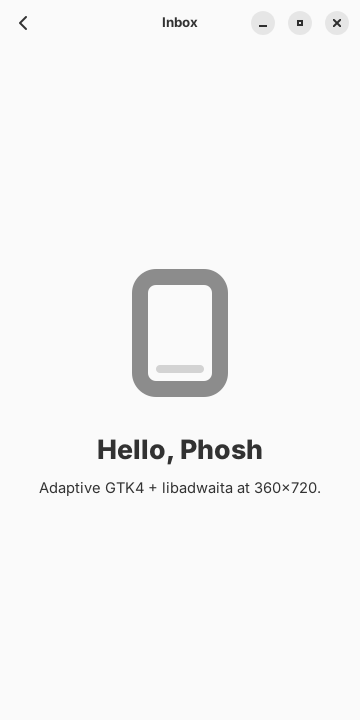
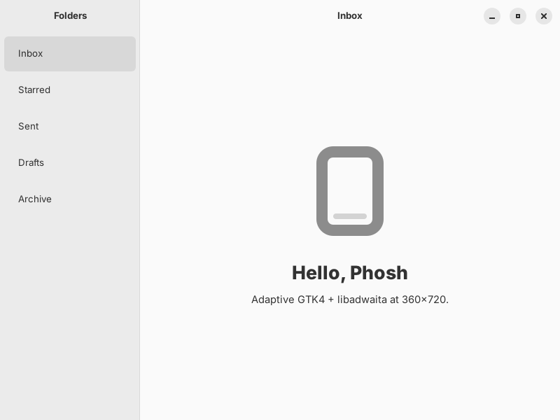

# phosh-toolkit

Shared toolkit for GTK4/libadwaita apps targeting [Phosh](https://phosh.mobi/)
phones (360×720 logical px, touch, aarch64). Each app lives in its own
repository and consumes this toolkit.

| Path | Purpose |
|------|---------|
| [`setup.sh`](setup.sh) | Idempotent Ubuntu 24.04 host setup: build tools, GTK4/libadwaita, Blueprint, Vala, Rust, PyGObject, Flatpak, Flathub remote. |
| [`AGENTS.md`](AGENTS.md) | Vendor-neutral rules for coding agents, shared by all app repositories. |
| [`scripts/screenshot.sh`](scripts/screenshot.sh) | Screenshot a GTK4 app at 360×720 via Broadway and Playwright. |
| [`.github/workflows/flatpak.yml`](.github/workflows/flatpak.yml) | Reusable workflow building Flatpak bundles for x86_64 and aarch64. |
| [`docs/`](docs/index.md) | Knowledge bundle (Open Knowledge Format v0.2). |
| [`examples/`](examples/) | Minimal adaptive demo app with desktop file, metainfo and Flatpak manifest. |

## Using the toolkit in an app repository

Check out the toolkit next to the app repositories:

```
workspace/
  phosh-toolkit/
  my-app/
```

**1. Environment setup script** (runs in the directory above the
repositories; the same lines work on a laptop or VM):

```sh
[ -d phosh-toolkit ] || git clone https://github.com/suitably/phosh-toolkit.git
bash phosh-toolkit/setup.sh
```

**2. Agent rules.** In the app repository, `CLAUDE.md` contains only
`@AGENTS.md`, and `AGENTS.md` starts with the toolkit import:

```markdown
@../phosh-toolkit/AGENTS.md

# My App

App-specific rules. The shared rules in ../phosh-toolkit/AGENTS.md apply as well.
```

**3. Flatpak CI.** `.github/workflows/flatpak.yml` in the app repository:

```yaml
name: Flatpak
on: [push, pull_request, workflow_dispatch]
jobs:
  flatpak:
    uses: suitably/phosh-toolkit/.github/workflows/flatpak.yml@main
    with:
      manifest: de.nexumia.MyApp.yml
```

The bundles appear as workflow artifacts `<app-id>-x86_64` and
`<app-id>-aarch64`.

**4. Screenshots:**

```sh
../phosh-toolkit/scripts/screenshot.sh -o shot.png -- ./_build/src/my-app
```

The demo app in `examples/` at 360×720 and 800×600:

 

More in [docs/toolkit-usage.md](docs/toolkit-usage.md).

## License

GPL-3.0, see [LICENSE](LICENSE).
